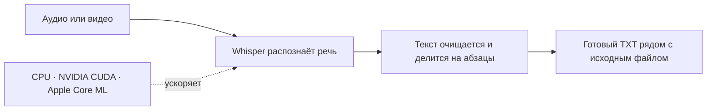

<div align="center">

<h1>Transcriber</h1>

<p><strong>Аудио и видео превращаются в аккуратный текст — локально на вашем компьютере.</strong></p>


<br>

<a href="https://github.com/maksimtuktiaev/Transcriber/releases"></a>


</div>

Transcriber распознаёт речь в аудио- и видеофайлах с помощью Whisper. Обработка выполняется на устройстве: выберите процессор, NVIDIA CUDA или Apple Core ML. Поддерживаются **Windows, Linux и macOS**.

## Скачать

Выберите установщик для своей системы. Все варианты и предыдущие версии доступны на странице [Releases](https://github.com/maksimtuktiaev/Transcriber/releases).

| Система | Готовая сборка |
|---|---|
| **Windows x64** | [Скачать установщик](https://github.com/maksimtuktiaev/Transcriber/releases/download/v1.0.0/TranscriberSetup-x64.exe) |
| **Linux x64** | [Пакет DEB](https://github.com/maksimtuktiaev/Transcriber/releases/download/v1.1.1/Transcriber-linux-x64.deb) · [Переносимый архив](https://github.com/maksimtuktiaev/Transcriber/releases/download/v1.1.1/Transcriber-linux-x64.tar.gz) |
| **macOS Apple Silicon** | [Образ DMG](https://github.com/maksimtuktiaev/Transcriber/releases/download/v1.1.1/Transcriber-osx-arm64.dmg) · [ZIP](https://github.com/maksimtuktiaev/Transcriber/releases/download/v1.1.1/Transcriber-osx-arm64.zip) |
| **macOS Intel** | [Образ DMG](https://github.com/maksimtuktiaev/Transcriber/releases/download/v1.1.1/Transcriber-osx-x64.dmg) · [ZIP](https://github.com/maksimtuktiaev/Transcriber/releases/download/v1.1.1/Transcriber-osx-x64.zip) |

## Как это работает



**Возможности:** локальное распознавание, выбор модели Whisper, ускорение на совместимом оборудовании, светлая и тёмная темы, сохранение форматированного текста рядом с записью.

## Установка для Windows

### Быстрая установка

1. Скачайте [установщик Windows](https://github.com/maksimtuktiaev/Transcriber/releases/download/v1.0.0/TranscriberSetup-x64.exe) из релиза v1.0.0.
2. Запустите установщик и следуйте подсказкам. Установка выполняется для текущего пользователя и обычно не требует прав администратора. При желании установщик создаст ярлык на рабочем столе.
3. Запустите **Transcriber** из меню «Пуск» или с рабочего стола.
4. При первом распознавании выберите модель. Приложение скачает её автоматически — на это потребуется интернет и свободное место на диске.
5. Добавьте аудио- или видеофайл, выберите модель и нажмите **Начать расшифровку**. После завершения откройте текст из приложения.

Установщик x64 включает приложение, .NET Runtime, библиотеки Whisper для CPU и CUDA, а также FFmpeg. Устанавливать .NET, FFmpeg или CUDA Toolkit отдельно для запуска в режиме CPU не требуется. Размер установщика — около 300 МБ.

### Системные требования

- Windows 10 или Windows 11, 64-разрядная система.
- Интернет при первом запуске выбранной модели.
- Свободное место для модели: около 140 МБ для `base`, 470 МБ для `small` и 1,6 ГБ для `turbo`.
- Для режима видеокарты — совместимая видеокарта NVIDIA и актуальный драйвер NVIDIA. Если CUDA недоступна, выберите процессор.

### Выбор CPU или GPU и темы

Откройте **Настройки** в главном окне:

- В разделе **Устройство распознавания** выберите **Процессор (CPU)** или **Видеокарта (CUDA)**. Настройка применяется к следующему запуску распознавания.
- В разделе **Тема приложения** выберите светлую или тёмную тему.

Если при выборе CUDA появляется ошибка или распознавание не начинается, установите свежий драйвер NVIDIA. Если GPU всё ещё недоступна, переключитесь на CPU.

### Модели Whisper

Модели загружаются отдельно при первом использовании и хранятся в `%LocalAppData%\Transcriber\models`.

| Модель | Примерный размер | Когда выбрать |
|---|---:|---|
| `turbo` | 1,6 ГБ | Хорошее качество и скорость на подходящем оборудовании |
| `small` | 470 МБ | Баланс размера и качества |
| `base` | 140 МБ | Быстрый старт и меньшая загрузка ресурсов |

Скачивание модели требует доступа к интернету. Файлы модели и пользовательские настройки хранятся отдельно от приложения и сохраняются после его удаления.

## Использование

1. Нажмите **Выбрать файл** и укажите запись.
2. Выберите модель Whisper.
3. Нажмите **Начать расшифровку** и дождитесь завершения.
4. Нажмите **Открыть текст** или **Показать в папке**.

Поддерживаемые форматы: MP3, WAV, M4A, MP4, MKV, MOV, FLAC и OGG. Результат сохраняется в `.txt` рядом с исходной записью. Распознанный текст очищается и форматируется в абзацы; повторы из записи сохраняются.

## Удаление приложения

Удалите Transcriber через **Параметры Windows → Приложения → Установленные приложения**. Можно также запустить деинсталлятор из папки установки. Пользовательские настройки и загруженные модели в `%LocalAppData%\Transcriber` не удаляются, чтобы не терять модели и предпочтения.

## Установка для Linux

В разделе [Releases](https://github.com/maksimtuktiaev/Transcriber/releases) скачайте пакет `Transcriber-linux-x64.deb` из релиза версии 1.1.1 или новее и установите его двойным щелчком в графическом центре приложений. Либо выполните:

```bash
sudo apt install ./Transcriber-linux-x64.deb
```

Пакет содержит .NET и библиотеки распознавания, а установщик автоматически подтянет FFmpeg и `libstdc++6`. Отдельно доступен переносимый архив `Transcriber-linux-x64.tar.gz`.

Перед первым запуском установите FFmpeg и системную библиотеку `libstdc++6`. Например, в Ubuntu или Debian:

```bash
sudo apt update
sudo apt install ffmpeg libstdc++6
```

Запустите приложение из распакованной папки:

```bash
chmod +x Transcriber
./Transcriber
```

Поддерживается Linux x64 с glibc 2.31 или новее. Для GPU режима требуется совместимая видеокарта NVIDIA и подходящий драйвер CUDA; иначе выберите процессор в **Настройки → Устройство распознавания**. При первом запуске модели скачиваются из интернета и хранятся в домашней папке пользователя.

## Установка для macOS

В [разделе релизов](https://github.com/maksimtuktiaev/Transcriber/releases) скачайте образ для своего Mac: `Transcriber-osx-arm64.dmg` для Apple Silicon (M1 и новее) или `Transcriber-osx-x64.dmg` для Mac с процессором Intel. Откройте образ и перетащите `Transcriber.app` в папку **Программы**. Также можно скачать ZIP-архив приложения.

Установите FFmpeg, например через [Homebrew](https://brew.sh/):

```bash
brew install ffmpeg
```

Если macOS не открывает приложение, нажмите на `Transcriber.app` правой кнопкой мыши, выберите **Открыть** и подтвердите запуск. Приложение не подписано сертификатом Apple Developer. В настройках можно выбрать **Apple Core ML** или процессор; на Mac Core ML использует доступное аппаратное ускорение Apple.

При первом распознавании потребуется интернет для загрузки выбранной модели Whisper. Модели и настройки сохраняются в профиле пользователя macOS.

## Сборка Linux и macOS из исходников

Кроссплатформенный интерфейс находится в `CrossPlatform/`. Для сборки нужен .NET 8 SDK. FFmpeg устанавливается отдельно через системный менеджер пакетов. Например:

```bash
dotnet run --project CrossPlatform/Transcriber.CrossPlatform.csproj
```

Автономные сборки для целевых систем создаются командой `dotnet publish` с нужным runtime identifier, например `linux-x64`, `osx-arm64` или `osx-x64`. GitHub Actions собирает архивы для проверки при каждом обновлении основной ветки, а прикрепляет их к релизу при публикации тега версии вида `v*`.

## Запуск из исходного кода

Для сборки Windows-версии понадобится Windows x64 и [.NET 8 SDK](https://dotnet.microsoft.com/download/dotnet/8.0). Для Linux/macOS см. раздел выше.

1. Скачайте или клонируйте этот репозиторий.
2. Откройте PowerShell в папке проекта.
3. Выполните:

```powershell
dotnet run -c Release
```

При первом запуске сборка скачает необходимые пакеты NuGet, поэтому требуется интернет.

Чтобы собрать автономную папку приложения:

```powershell
dotnet publish -c Release -r win-x64 --self-contained true -o publish
```

Для публикации готового установщика используется сценарий Inno Setup из `installer/Transcriber.iss`; шаги подготовки описаны в [installer/README.md](installer/README.md). Папки `installer/payload` и `installer/third-party/ffmpeg-extracted` содержат локальные файлы сборки и не нужны для запуска из исходников.

## Сторонние компоненты и лицензии

Приложение использует Whisper.net и whisper.cpp, FFmpeg, а также компоненты .NET. Уведомления о сторонних компонентах включаются в установщик и находятся в папке `licenses` рядом с установленным приложением. Перед распространением сборки сохраняйте эти уведомления и соблюдайте условия соответствующих лицензий.

## Если возникла проблема

- **Модель не скачивается:** проверьте интернет-соединение и свободное место; повторите попытку позже.
- **Не удаётся открыть аудио или видео:** используйте актуальный установщик, содержащий FFmpeg, и убедитесь, что файл не повреждён.
- **CUDA недоступна:** обновите драйвер NVIDIA или выберите CPU в настройках.
- **Нужно освободить место:** удалите ненужные модели из `%LocalAppData%\Transcriber\models`.

Для сообщения об ошибке укажите версию Windows, выбранную модель и режим CPU/GPU, а также текст сообщения об ошибке.
